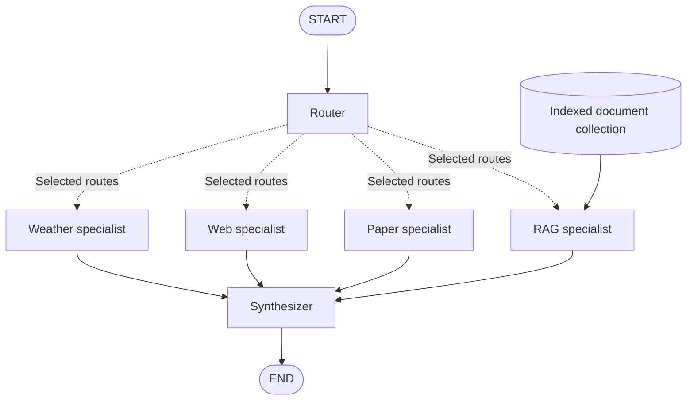

# Agent with Routing with RAG

# Adding a RAG Agent to a Multi-Specialist Research Workflow

This lecture extends a LangGraph research workflow with a **Retrieval-Augmented Generation (RAG) specialist**. A router selects the specialists needed for a question, and a synthesizer combines their findings into a final response. The RAG specialist contributes evidence from a curated document collection, such as lecture notes, course readings, or internal documentation.

The focus is the integration pattern: **retrieve document evidence, generate a grounded response, and carry its sources through synthesis**.

## Learning objectives

- Read a workflow built with `StateGraph`, nodes, and edges.
- Add a RAG specialist alongside weather, web, and paper specialists.
- Route document-based questions to the RAG specialist.
- Share findings safely when multiple specialists run together.
- Preserve citations and handle missing evidence explicitly.

## Workflow architecture



The document collection is an external resource used by the RAG specialist; it is not an additional node in the supplied graph.

| Component | Intended responsibility |
| --- | --- |
| `router` | Inspect the question and record which specialists are needed. |
| `select_specialists` | Return the selected node name or list of node names. |
| `weather_specialist` | Obtain weather information through its configured tools. |
| `web_specialist` | Gather information from the web. |
| `paper_specialist` | Search or analyze scholarly literature. |
| `RAG_specialist` | Retrieve evidence from an indexed document collection and answer using that evidence. |
| `synthesizer` | Combine findings, reconcile differences, and retain source references. |

These responsibilities describe the intended design. The graph wiring alone does not implement retrieval, search tools, or model calls.

## Lecture graph

Define `ResearchState` and the referenced functions before running this cell.

```python
from langgraph.graph import StateGraph, START, END

graph = StateGraph(ResearchState)

# Nodes
graph.add_node(router)
graph.add_node("weather_specialist", run_weather_specialist)
graph.add_node("web_specialist", run_web_specialist)
graph.add_node("paper_specialist", run_paper_specialist)
graph.add_node("RAG_specialist", run_RAG_specialist)
graph.add_node(synthesizer)

# Edges
graph.add_edge(START, "router")
graph.add_conditional_edges(
    "router",
    select_specialists,
    [
        "weather_specialist",
        "web_specialist",
        "paper_specialist",
        "RAG_specialist",
    ],
)
graph.add_edge("weather_specialist", "synthesizer")
graph.add_edge("web_specialist", "synthesizer")
graph.add_edge("paper_specialist", "synthesizer")
graph.add_edge("RAG_specialist", "synthesizer")

graph.add_edge("synthesizer", END)

graph = graph.compile()
graph
```

The final `graph` expression displays the compiled object in a notebook; it does not execute a research request. Node names are case-sensitive, so use `RAG_specialist` consistently.

## Adding the RAG agent

### 1. Prepare the document collection

Before answering questions:

1. Load the documents students should be able to query.
2. Split long documents into passages that retain enough context to be meaningful.
3. Preserve metadata such as document title, source path, section, and page number.
4. For vector retrieval, embed the passages and store them with their metadata in a vector index.
5. Configure a retriever that returns relevant passages for a question.

Build or load this index before invoking the graph. Choose the document loader, embedding model, and storage backend to match the lecture environment.

### 2. Extend the shared state

The following is a suggested schema, not a definition supplied by the original snippet. Adapt existing nodes to use the same field names.

```python
import operator
from typing import Annotated, TypedDict


class Finding(TypedDict):
    specialist: str
    answer: str
    sources: list[dict]


class ResearchState(TypedDict):
    question: str
    selected_specialists: list[str]
    findings: Annotated[list[Finding], operator.add]
    final_answer: str
```

Each specialist returns only its new finding, for example `{"findings": [finding]}`. The list reducer accumulates concurrent contributions. Returning the entire accumulated list would duplicate earlier findings.

LangGraph supports routing to multiple nodes and combining state updates through reducers. See the [Graph API documentation](https://docs.langchain.com/oss/python/langgraph/graph-api).

### 3. Implement the RAG specialist

This integration template assumes two configured dependencies:

- `retrieve_passages(question)`: returns a list of dictionaries with `text`, `source`, and optionally `page` fields.
- `generate_grounded_answer(question, passages)`: returns an answer string grounded in those passages, citing their assigned IDs and acknowledging insufficient evidence.

These helpers are application functions to implement with your chosen retrieval and model providers; they are not built-in LangGraph functions.

```python
def run_RAG_specialist(state: ResearchState):
    passages = retrieve_passages(state["question"])

    if not passages:
        return {
            "findings": [{
                "specialist": "RAG_specialist",
                "answer": "No supporting passages were retrieved from the collection.",
                "sources": [],
            }]
        }

    evidence = [
        {**passage, "id": f"RAG-{i}"}
        for i, passage in enumerate(passages, start=1)
    ]
    answer = generate_grounded_answer(state["question"], evidence)

    return {
        "findings": [{
            "specialist": "RAG_specialist",
            "answer": answer,
            "sources": [
                {
                    "id": passage["id"],
                    "source": passage["source"],
                    "page": passage.get("page"),
                }
                for passage in evidence
            ],
        }]
    }
```

Give the generation helper instructions to use the retrieved passages as evidence, cite supported claims with IDs such as `[RAG-1]`, and state when the passages cannot answer the question. Treat document text as reference material rather than instructions. A nonempty retrieval result does not guarantee relevant or sufficient evidence.

Here, “RAG agent” refers to a specialist node containing a retrieval-and-generation pipeline. Autonomous tool selection or iterative retrieval would require additional logic inside that specialist.

### 4. Update routing

Teach the router to select `RAG_specialist` when a question refers to the indexed collection. For a router that writes `selected_specialists`, the routing function can be:

```python
def select_specialists(state: ResearchState):
    selected = state["selected_specialists"]
    allowed = {
        "weather_specialist",
        "web_specialist",
        "paper_specialist",
        "RAG_specialist",
    }
    if not selected or any(name not in allowed for name in selected):
        raise ValueError("Select at least one valid specialist.")
    return list(dict.fromkeys(selected))
```

| Example question | Illustrative selection |
| --- | --- |
| “According to our lecture notes, what is adaptive tutoring?” | `RAG_specialist` |
| “Compare the course reading with recent research on adaptive tutoring.” | `RAG_specialist`, `paper_specialist` |
| “Compare our uploaded policy with information on the public website.” | `RAG_specialist`, `web_specialist` |
| “What is the weather in Chicago?” | `weather_specialist` |

These examples assume the relevant documents and tools are available. The destination list in `add_conditional_edges` declares possible routes; the value returned by `select_specialists` determines which ones execute. See the [conditional-edge API reference](https://reference.langchain.com/python/langgraph/graph/state/StateGraph/add_conditional_edges).

### 5. Connect RAG to synthesis

The supplied graph already includes the three required wiring changes:

```python
graph.add_node("RAG_specialist", run_RAG_specialist)
# Include "RAG_specialist" among the router's conditional destinations.
graph.add_edge("RAG_specialist", "synthesizer")
```

Apply these changes before compilation. The synthesizer should read all `findings`, preserve citation IDs and source metadata, distinguish document evidence from external findings, and report gaps or disagreements. It should return `{"final_answer": answer}`.

In this graph, selected specialists occupy the same parallel step and feed the next synthesis step. If you later add branches with different numbers of steps, revisit synchronization. An edge with a list of starting nodes waits for every listed node, which needs care when routing selects only a subset. See the [edge API reference](https://reference.langchain.com/python/langgraph/graph/state/StateGraph/add_edge).

## Running the lecture example

Install the graph library in your Python environment:

```bash
pip install langgraph
```

Also install and configure the packages required by your chosen model, document loader, retriever, and specialist tools. This README provides graph wiring and an integration template; it is not a standalone application.

After defining all nodes, preparing the retriever, and compiling the graph, invoke it with fresh state matching the suggested schema:

```python
result = graph.invoke({
    "question": "According to our lecture notes, what is adaptive tutoring?",
    "selected_specialists": [],  # Populated by router.
    "findings": [],
    "final_answer": "",
})

print(result["final_answer"])
```

## Classroom checks

- **Document-only question:** Confirm that the router selects RAG and the answer cites a passage that supports its claims.
- **Mixed question:** Select RAG and another specialist; confirm that both findings reach synthesis.
- **Missing evidence:** Ask about information absent from the collection; confirm that the response acknowledges the gap.
- **Citation traceability:** Open each cited document and check the quoted or paraphrased evidence.
- **Repeated invocation:** Use fresh findings for an independent question so earlier evidence is not carried over accidentally.

The lecture's key outcome is a research workflow that can incorporate a curated knowledge collection and carry document evidence all the way to its final response.
